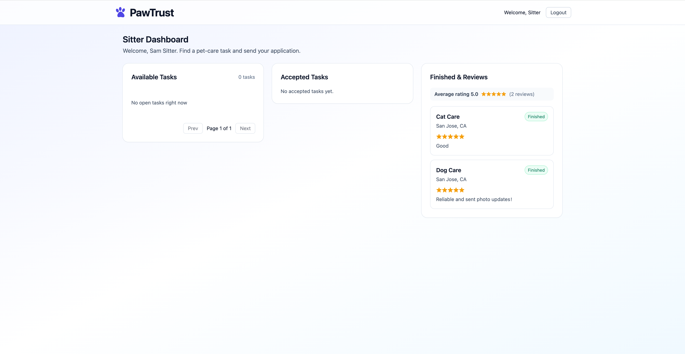

# PawTrust

A MERN web app connecting pet owners with pet sitters. See [`docs/PRD.md`](docs/PRD.md) and [`AGENTS.md`](AGENTS.md).

## Live demo

| | URL |
| --- | --- |
| **App (Vercel)** | https://cs-6983-project2.vercel.app |
| **API (Render)** | https://pawtrust-backend.onrender.com/pawtrust/health |

The API runs on Render's free plan and sleeps after about 15 minutes without traffic, so the first request can take 30–60 seconds. Register your own owner and sitter accounts to try it; see [Deployment](#deployment) for a walkthrough.

## API documentation

The complete [OpenAPI 3.0 specification](docs/openapi.json) documents all 18 API operations, authentication, permissions, request and response schemas, errors and examples.

Import `docs/openapi.json` into Swagger Editor or another OpenAPI viewer to browse the reference. The default server is local development; the production server is also listed. For protected requests, log in and use the returned JWT as a bearer token. List endpoints return full arrays; pagination is handled by the frontend.

## Local development

Requirements: Node.js 22.23.4 (pinned in `.nvmrc`; run `nvm install && nvm use` from the repository root), a MongoDB connection string (Atlas, or a local MongoDB replica set for transaction tests).

### Backend (`pawtrust-backend`)

```bash
cd pawtrust-backend
cp .env.example .env      # fill in PawTrust_DB_URI and JWT_SECRET
npm install
npm run seed              # dummy owner/sitter accounts in pawtrust_dev
npm start                 # http://localhost:8000/pawtrust/health → {"status":"ok"}
npm test                  # runs against PawTrust_db=pawtrust_test
```

Unique indexes (`users.email`, `applications(taskId, sitterId)`, `reviews.taskId`) are created on startup.

### Frontend (`pawtrust-frontend`)

```bash
cd pawtrust-frontend
cp .env.example .env      # VITE_API_BASE_URL=http://localhost:<backend PORT>
npm install
npm run dev               # http://localhost:5173
npm run lint
```

## Authentication frontend — Issue #6

Login and registration follow [Design.md](Design.md), the shared frontend design specification. The AGENTS.md reference makes it the entry point for subsequent frontend work.

Set `VITE_API_BASE_URL` to the backend origin, without `/pawtrust`. Registration and login require the APIs from #4 and #5. Authentication stores the JWT and safe user fields, redirects by role and clears the session on logout or expired authorization.

```bash
cd pawtrust-frontend
npm ci
npm test
npm run lint
npm run build
```

Tests use Vitest, Testing Library and jsdom with mocked API responses. See [auth handoff and verification](docs/issue-6-auth-handoff.md) for contracts and integration status.

## Testing and CI — Issue #2

Run frontend checks from `pawtrust-frontend`: `npm ci`, `npm run lint`,
`npm test`, and `npm run build`. Vitest uses React Testing Library and jsdom.

Run backend checks from `pawtrust-backend`: `npm ci`, then `npm test` with
`PawTrust_DB_URI` pointing to a dedicated test MongoDB instance. Mocha runs
`test/**/*.test.js` with Chai and Supertest. The test setup forces the database
name to `pawtrust_test`; tests clear fixture data, so do not share that database
with another running test process. Existing health and frontend tests provide
the sample tests required by #2.

The [CI workflow](.github/workflows/ci.yml) runs on every PR targeting `main`,
pushes to `main`, and manual dispatch. Both jobs read the Node version from
`.nvmrc` and install from their lockfiles with `npm ci`:

- **Frontend:** ESLint, all component tests, and a production build.
- **Backend:** all integration tests against a fresh, single-node MongoDB 7 replica set.

CI needs no Atlas credentials or repository secrets. Its test database and
signing key are disposable. The backend job initializes the replica set and waits
for a writable primary before running tests, including transaction-based features.
It prints database logs on failure and removes the container and volumes afterward.
CI reports checks; it does not configure branch protection or deploy.

## Deployment

| Part | Platform | Root directory | Deploys from |
| --- | --- | --- | --- |
| Frontend | Vercel | `pawtrust-frontend` | `main` (production) and every PR (preview) |
| Backend | Render web service (free) | `pawtrust-backend` | `main`, after CI checks pass |
| Database | MongoDB Atlas M0 (replica set) | — | database `pawtrust_prod` |

Production secrets are set only in the Render and Vercel dashboards, never in the repository.

### 1. Database (MongoDB Atlas)

1. Create a free **M0** cluster. It is a replica set, so the accept and review transactions work.
2. **Database Access:** create a database user.
3. **Network Access:** allow `0.0.0.0/0`. Render's free plan has no fixed outbound IP; access is protected by the database user's password.
4. **Connect → Drivers:** copy the `mongodb+srv://…` connection string.

The backend creates the unique indexes in `pawtrust_prod` on startup.

### 2. Backend (Render)

New → **Web Service**, connect this repository, then:

| Setting | Value |
| --- | --- |
| Root Directory | `pawtrust-backend` |
| Build Command | `npm ci` |
| Start Command | `npm start` |
| Health Check Path | `/pawtrust/health` |
| Auto-Deploy | After CI Checks Pass |

Environment variables:

| Variable | Value |
| --- | --- |
| `PawTrust_DB_URI` | Atlas connection string |
| `PawTrust_db` | `pawtrust_prod` |
| `JWT_SECRET` | a long random string, e.g. from `openssl rand -hex 32` |
| `NODE_ENV` | `production` (disables the localhost CORS exception) |
| `CORS_ORIGIN` | the Vercel production URL, with no trailing `/` |
| `VERCEL_PROJECT` | Vercel project name, to allow PR previews |
| `VERCEL_SCOPE` | Vercel team slug, the last part of a preview URL |

Check: `GET /pawtrust/health` returns `{"status":"ok"}`.

### 3. Frontend (Vercel)

Add New → **Project**, import this repository, then:

| Setting | Value |
| --- | --- |
| Root Directory | `pawtrust-frontend` |
| Framework Preset | Vite |
| Node.js Version | 22.x |
| `VITE_API_BASE_URL` | the Render URL with no trailing `/` and no `/pawtrust`, for Production **and** Preview |

`VITE_API_BASE_URL` is compiled into the bundle, so redeploy after changing it. [`vercel.json`](pawtrust-frontend/vercel.json) rewrites all routes to `index.html`, so refreshing `/owner` or `/sitter` works.

Every pull request gets a Vercel preview URL. The backend accepts requests from previews of this project only (`https://<VERCEL_PROJECT>-<hash>-<VERCEL_SCOPE>.vercel.app`).

### Troubleshooting

| Symptom | Fix |
| --- | --- |
| Render log: `SSL alert number 80` / `MongoServerSelectionError` | Atlas Network Access does not allow `0.0.0.0/0` |
| Render log: `Missing env vars: …` | A required variable is missing or misspelled (`PawTrust_db` uses lowercase `db`) |
| App shows "Unable to connect"; browser console shows a CORS error | `CORS_ORIGIN` must match the app URL exactly, including `https://` and no trailing `/` |
| App shows "Unable to connect"; no CORS error | `VITE_API_BASE_URL` is wrong; fix it and redeploy on Vercel |

### Security checks

The [Security workflow](.github/workflows/security.yml) runs on every PR, on pushes to `main` and weekly:

- `npm audit --omit=dev --audit-level=high` for the backend and frontend, failing on high or critical vulnerabilities in production dependencies.
- CodeQL static analysis of the JavaScript code.

[Dependabot](.github/dependabot.yml) opens weekly update PRs for npm packages and GitHub Actions.

### Production walkthrough (#17)

The full flow was verified on the live site with one owner and two sitters in separate browser sessions. Screenshots are in [`docs/evidence/issue-17`](docs/evidence/issue-17).

| Step | Screenshot |
| --- | --- |
| Login and registration | [Login](docs/evidence/issue-17/01-login.png) · [Register](docs/evidence/issue-17/02-register.png) |
| Owner posts a task | [Dashboard](docs/evidence/issue-17/03-owner-dashboard.png) · [Form](docs/evidence/issue-17/04-owner-post-task-1.png) · [Posted](docs/evidence/issue-17/05-owner-post-task-2.png) |
| Two sitters apply | [Sitter dashboard](docs/evidence/issue-17/06-sitter-dashboard.png) · [Sitter A](docs/evidence/issue-17/07-sitter-a-apply-1.png) · [Applied](docs/evidence/issue-17/08-sitter-a-apply-2.png) · [Sitter B](docs/evidence/issue-17/09-sitter-b-apply.png) |
| Owner accepts one sitter | [Applications](docs/evidence/issue-17/10-owner-applications.png) · [Accepted / Not selected](docs/evidence/issue-17/11-owner-accepted-assigned.png) |
| Sitter finishes the task | [Mark as Finished](docs/evidence/issue-17/12-sitter-mark-finished.png) |
| Owner reviews the sitter | [Review button](docs/evidence/issue-17/13-owner-review-button.png) · [Review modal](docs/evidence/issue-17/14-owner-review-modal.png) · [Reviewed](docs/evidence/issue-17/15-owner-reviewed.png) |
| Sitter sees the review | [Stars and average rating](docs/evidence/issue-17/16-sitter-sees-review.png) |



## Automated browser tests

See [E2E setup and coverage](tests/e2e/README.md) for the Playwright suite that runs the complete pet-care workflow against the real API and a local MongoDB replica set. The separate E2E workflow publishes an HTML report and failure traces in GitHub Actions.
