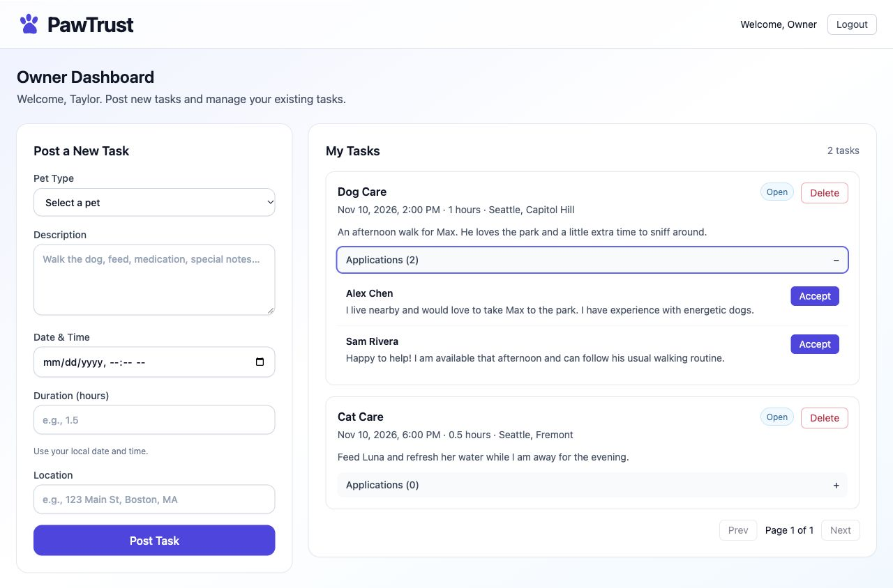
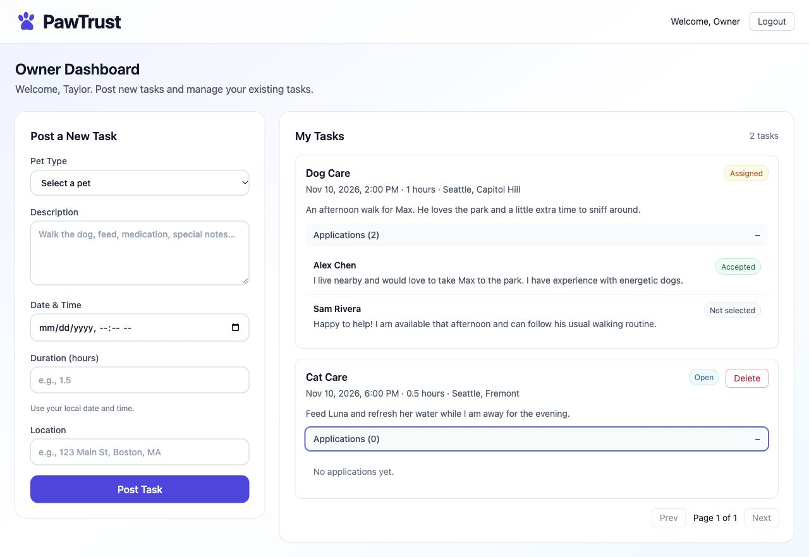

# Issue #11 — Accept a sitter

Implements US-7 and BR-4 using the existing Design.md and owner mockup.

## Behavior and acceptance criteria

- [x] `GET /pawtrust/applications/owner` returns only applications for the authenticated owner's tasks, including sitter names and messages.
- [x] `POST /pawtrust/accept` accepts `{ taskId, applicationId }`; ownership is derived from the verified JWT.
- [x] One MongoDB transaction assigns the task, stores `acceptedSitterId`, accepts the chosen application, and rejects the others.
- [x] Invalid identifiers return 400; missing/invalid/expired authentication returns 401; wrong role or owner returns 403; missing records return 404; repeated or competing acceptance returns 409.
- [x] Concurrent acceptance allows exactly one winner. A failed application write rolls back the task and all application changes.
- [x] The owner dashboard displays applicants, a confirmation step, pending/error states, and Accepted / Not selected labels. It refetches server state after acceptance or conflict.
- [x] Supertest and React Testing Library cover the acceptance behavior and status labels.

## Validation

- Backend: 102 passing tests against an isolated MongoDB 7 replica set.
- Coverage of the new controller/DAO: 96.2% lines, 88.23% branches (c8).
- Frontend: 57 passing tests; lint and production build passed.
- Browser: fixture owner login, application names/messages, cancel/focus return, accept, assigned status, accepted/rejected labels, empty list, and persistence after reload verified.
- Tests were first run against missing routes and controls, then rerun after implementation. Original red logs are retained locally.
- Backend has no lint script. No dependencies were added.

## Integration

Application records were seeded for this preview using the PRD schema. The complete sitter-apply-to-owner-accept browser flow can be verified after #9 provides application creation.

Transactions require a replica set or MongoDB Atlas. The standalone MongoDB CI service proposed in #27 must be upgraded to a replica set when these transaction tests are integrated.

All changes are within #11: API/controller/DAO wiring, owner application UI, related tests, and this evidence. Production data was not used.

## Screenshots

